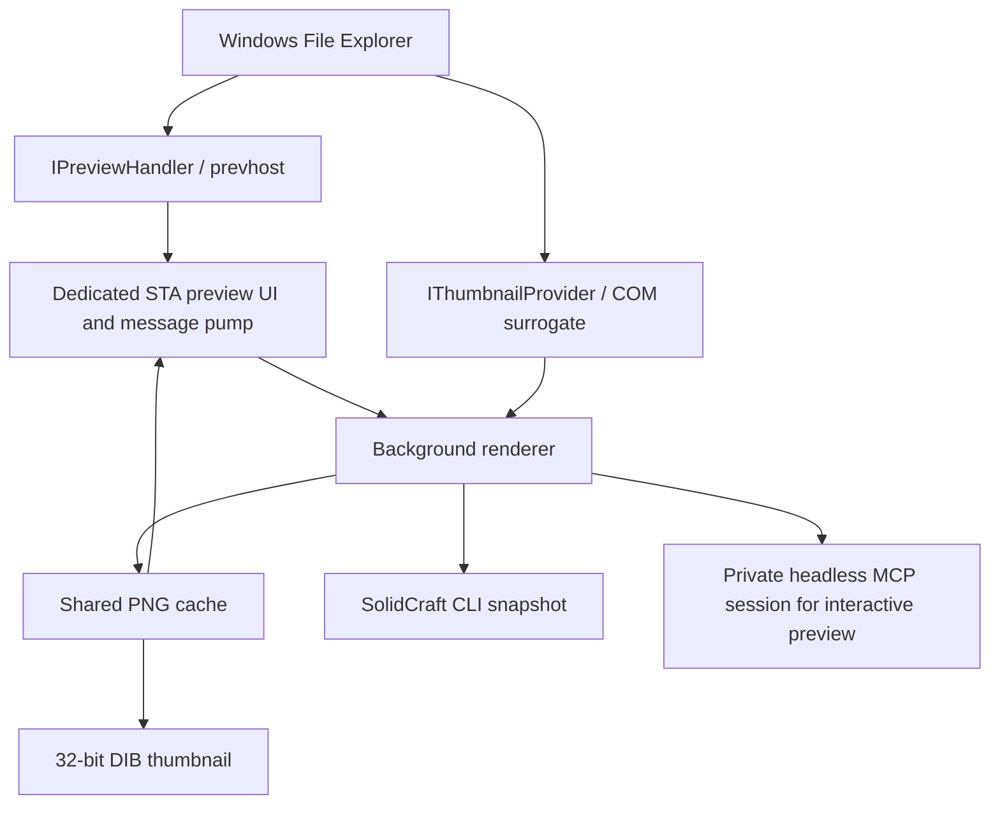

# Architecture

COM handlers initialize from streams; copying the stream occurs on the owning COM thread. Preview rendering is performed in the background; thumbnails are synchronous by interface contract. Slow input streams can still block. Model evaluation computes camera framing; the cube is drawn locally, not by SolidCraft. Only the latest requested preview orientation is prioritized. The live session is private and headless, not connected to a desktop design.

The static PNG cache uses SHA-256 input content, format, CLI identity and render settings. Adaptive orbit views also include camera/size information (including zoom through distance and world-space pan through target). Pan is stored in units of the bounding-box diagonal so it remains independent of model units and survives orbit. Interactive wheel and drag requests use the latest state without blocking the UI. The cache lives in `%USERPROFILE%\AppData\LocalLow\SolidPreview\cache-v1`. Its target is 512 MiB; input copies are capped at 128 MiB. Static rendering uses 32 lock buckets and two process slots. Preview/thumbnail timeout budgets are best-effort (18/8 seconds for their static render path). Drag frames are temporary. Explorer maintains a separate thumbnail cache.

COM registration is per-user (`HKCU`), Apartment threading. Installer state lives in `%LOCALAPPDATA%\SolidPreview\restore.json`; compiled DLLs live in versioned directories nearby. Existing default applications and UserChoice values are untouched. Competing ProgID registrations may take precedence. Do not change Windows process isolation or low-integrity policies to force the handler to work.

## Upstream references

- [SolidCraft documentation](https://docs.solidcraft.io/)
- [SolidCraft MCP documentation](https://docs.solidcraft.io/dev/mcp.html)
- [Microsoft preview handlers](https://learn.microsoft.com/en-us/windows/win32/shell/preview-handlers)
- [Microsoft thumbnail providers](https://learn.microsoft.com/en-us/windows/win32/shell/thumbnail-providers)
